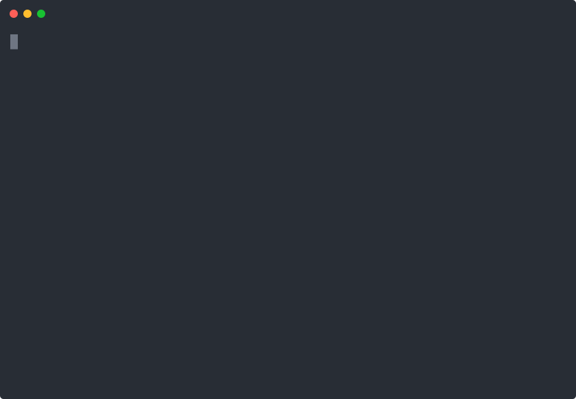

# weightwatch-ci


*Real run against a real fixture: one budgeted path over cap, one within it.*

Fail CI before an unbudgeted dependency ships — not after a user complains the app got slow.

## The problem it fixes
Two files importing the same package look free the second time to most size tools, but a
bundler still has to decide whether to dedupe, chunk, or double-ship it — and nobody notices
until the bundle is already in production. weightwatch-ci prices every package **once**
across your whole tree, attributes it to the first file that imports it, and checks that
total against a budget you set per path in `.weightwatch.json`.

## Install
```
npm install github:growaleaf/weightwatch-ci
```
No registry account, no seat, no telemetry. The license check is fully offline.

## Use
```
echo '{ "budgets": { "src/checkout": 20 } }' > .weightwatch.json
WEIGHTWATCH_KEY=<your key> node node_modules/weightwatch-ci/cli.js check
```
Exit codes: `0` all paths within budget · `1` at least one path over budget · `2` no
`.weightwatch.json` budgets configured · `3` missing/invalid license key.

## Pro ($7 one-time)
This CLI. No subscription, no per-seat pricing, no recurring charge.

## Honest by design
This does not claim to match your exact bundler's output — tree-shaking and chunking are
your bundler's job. The first-payer dedup is bundler-independent and always correct; the
byte number itself is a close gzip approximation of the package's own entry file.

Made by The Hive.
